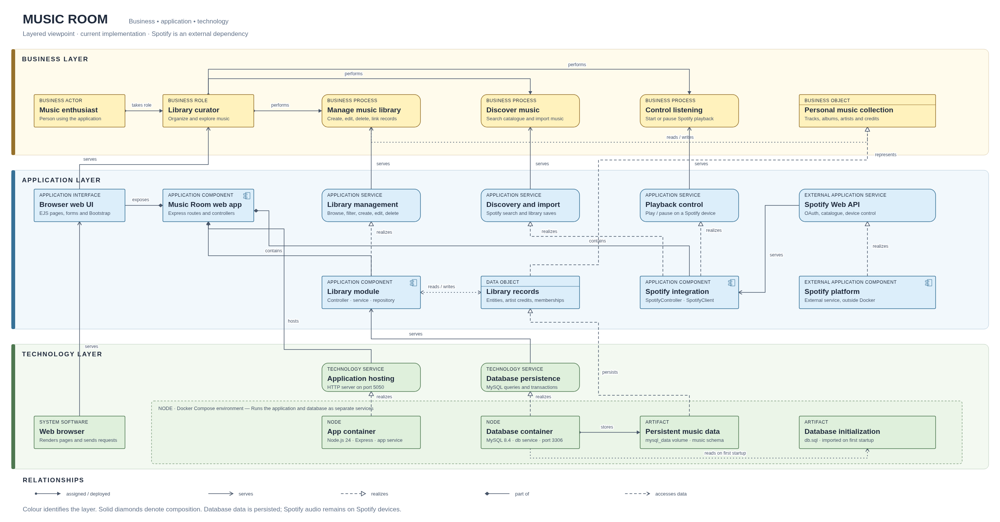

# Music Room — ArchiMate business design



The diagram is **2640 × 1380**, with three horizontal layers. The SVG scales
without losing detail and is suitable for a report or presentation.

| File | Use |
| --- | --- |
| [music-room-archimate.svg](music-room-archimate.svg) | Open in a browser; scalable diagram for sharing/export. |
| [music-room-archimate.png](music-room-archimate.png) | Image for documents, slides, and quick previews. |
| [music-room.archimate](music-room.archimate) | Editable native Archi model, with elements, relationships, colors, and a landscape view. |
| [model.json](model.json) | Editable element definitions, positions, and relationship routes. |
| [generate.py](generate.py) | Regenerates the SVG and native Archi model using Python's standard library. |

## Edit in Archi

1. Open `music-room.archimate` in **Archi**, using **File → Open**.
2. Expand **Views** in the model tree.
3. Open **Music Room — Landscape Layered View**.
4. Move elements, edit labels, change colors, and add relationships as needed.
5. Save the model or export the view as an image from Archi.

This is a native `.archimate` file, rather than an Open Group exchange XML file;
open it as a model instead of using the XML exchange importer. Elements are stored
in Business, Application, and Technology folders. Layer bands are graphical
groups. The SVG includes explanatory subtitles; in Archi the corresponding
explanations are in each element's documentation. Archi supplies its native
element icons and relationship notation.

## Layers and scope

**Business — yellow.** A music enthusiast takes the role of library curator and
manages a collection, discovers music, and controls listening. These are conceptual
business roles and activities, not additional authorization roles implemented in
the code. One person can perform all of them.

**Application — blue.** The Express application exposes an EJS/Bootstrap web
interface. Library management, discovery/import, and playback are application
services. The library and Spotify integration components realize those services.
Library metadata is represented by a data object. The external Spotify platform
realizes its Web API service, which serves the local Spotify integration.

**Technology — green.** A web browser accesses the UI. Docker Compose runs the
Node.js application and MySQL in separate containers. Their nodes realize hosting
and persistence services. The `mysql_data` volume persists the library records.
`db.sql` is an initialization artifact read on first database startup.

The model describes the current implementation. It does not introduce playlists,
user accounts, cloud deployment, audio uploads, or direct audio streaming. Spotify
playback controls an existing Spotify device; the database holds metadata and
image locations. Spotify login tokens remain in the app process's memory.

## Relationships

| Notation | Meaning in this project |
| --- | --- |
| Assignment — filled source circle and filled arrow | A person takes a role, a role performs a process, or a node stores an artifact. |
| Serving — solid line, open arrow | An application or technology service supports its consumer. The arrow points to the consumer. |
| Realization — dashed line, hollow triangle | A component realizes a service, or stored data realizes logical records. |
| Composition — filled diamond at the whole | The web app contains modules/interfaces. The Docker node contains two container nodes. |
| Access — dotted line, open arrow | A process/component reads or writes an object. Arrows at both ends indicate read/write. |

The two container nodes are nested in the Docker environment. Their composition
relationships exist in the editable model but are hidden as connecting lines in
the view, because nesting already expresses them. Volume and initialization
artifacts are also positioned within the deployment boundary. Lines crossing
without a junction do not indicate a connection. The colors distinguish layers;
the typed elements and relationship notation carry the model's meaning.

## Mapping to code

| Diagram element | Implementation |
| --- | --- |
| Music Room web app | `app.js`, `lib/routes/index.js` |
| Browser web UI | `views/`, Bootstrap, `views/css/styles.css` |
| Library module | `LibraryController`, `LibraryService`, `LibraryRepository`, model classes |
| Spotify integration | `SpotifyController`, `SpotifyClient` |
| Library records | `albums`, `tracks`, `artists`, `track_artists`, `album_artists`, `artist_memberships` |
| App container | `Dockerfile`, Compose service `app` |
| Database container | Compose service `db`, image `mysql:8.4` |
| Persistent music data | Compose volume `mysql_data`, MySQL database `music` |
| Database initialization | `db.sql`, mounted into `/docker-entrypoint-initdb.d/` |

This is a layered architecture view, separate from the UML class diagram in
`docs/class-diagram.svg`. It shows business responsibilities and their application
and technology support, rather than individual class methods or SQL cardinalities.

## Regenerate and validate

```sh
python3 docs/business_design/generate.py
```

The generator checks unique model identifiers, element/view/relationship
references, and landscape dimensions. The XML types and their serialization
aliases were checked against the official Archi metamodel. The SVG was visually
reviewed in Chrome. The Archi GUI itself was not used to open the generated model.
The PNG is a browser-rendered export; regenerate it from the SVG or export a new
image from Archi after making changes. Changes made directly in Archi are not
written back to `model.json`; keep your edited model or update the source before
running the generator again.

## References

- [Archi User Guide](https://www.archimatetool.com/downloads/archi/Archi%20User%20Guide.pdf)
- [Official Archi model XML example](https://github.com/archimatetool/archi/blob/master/tests/com.archimatetool.editor.tests/testdata/models/testmodel1.archimate)
- [Official Archi metamodel and serialization aliases](https://github.com/archimatetool/archi/blob/master/com.archimatetool.model/model/archimate.ecore)
- [The Open Group: ArchiMate introduction](https://archimate-community.pages.opengroup.org/workgroups/archimate-101/)
